# Projeto - Cidades ESGInteligentes

## 🌿 Carbon API — Gestão de Emissões de Carbono (ESG) com DevOps

API RESTful em **.NET 8** para gestão de sustentabilidade empresarial: monitoramento de emissões de carbono, iniciativas de redução e compensação de gases de efeito estufa (GEE). Este repositório aplica práticas completas de **DevOps** sobre a API: containerização, orquestração, pipeline de CI/CD e deploy automatizado em dois ambientes (**staging** e **produção**) no Azure.

| Campo | Informação |
|---|---|
| **Instituição** | FIAP — Análise e Desenvolvimento de Sistemas |
| **Fase** | Navegando pelo mundo DevOps |
| **Equipe** | Gabriel Alves Oliveira – RM562365<br>Marcos Antão Fernandes Junior – RM563156<br>Marcos Eduardo Alves de Oliveira Freitas – RM555914<br>Danilo Ferreira Chaves – RM565765<br>Hevilyn Romano Garcia – RM566426 |
| **Repositório** | https://github.com/GabrielOlliver/carbon-api-devops |

---

## 🗺️ Arquitetura

```
 Desenvolvedor ──git push──► GitHub (main)
                                 │
                                 ▼
                ┌──────────── GitHub Actions ─────────────┐
                │ 1. Build e Testes  (dotnet build/test)  │
                │ 2. Build e Publicacao da Imagem ─► GHCR │
                │ 3. Deploy Staging     (automatico)      │
                │ 4. Deploy Producao    (aprovacao manual)│
                └──────────────────┬──────────────────────┘
                                   │ SSH + docker compose
                                   ▼
            Azure VM — Ubuntu 22.04 (Chile Central)
   ┌──────────── carbon-staging ────────────┐ ┌─────────── carbon-production ──────────┐
   │ carbon-api :8081  ──►  oracle-db       │ │ carbon-api :8080  ──►  oracle-db       │
   │ rede: carbon-staging_carbon-net        │ │ rede: carbon-production_carbon-net     │
   │ volume: carbon-staging_oracle_data     │ │ volume: carbon-production_oracle_data  │
   └────────────────────────────────────────┘ └────────────────────────────────────────┘
```

Cada ambiente é um **projeto Docker Compose isolado** (`-p carbon-staging` / `-p carbon-production`): containers, rede, volume, portas e segredos próprios — e ambos rodam **exatamente a mesma imagem** (tag = SHA do commit).

### Estrutura do repositório

```
carbon-api-devops/
├── .github/workflows/
│   ├── ci-cd.yml          ← pipeline principal (CI + CD)
│   └── deploy.yml         ← deploy reutilizável (staging/produção)
├── docs/prints/           ← evidências de execução
├── infra/cloud-init.yml   ← provisionamento da VM (Docker + swap)
├── src/CarbonApi/         ← código-fonte da API
├── tests/CarbonApi.Tests/ ← testes automatizados (xUnit)
├── Dockerfile
├── docker-compose.yml
├── .env.example           ← modelo das variáveis de ambiente
└── README.md
```

---

## 🐳 Como executar localmente com Docker

**Pré-requisitos:** [Docker Desktop](https://docker.com/products/docker-desktop) (com ~4 GB de RAM livres para o Oracle). O .NET SDK 8 só é necessário para rodar os testes fora do Docker.

```bash
# 1. Clonar o repositório
git clone https://github.com/GabrielOlliver/carbon-api-devops.git
cd carbon-api-devops

# 2. Criar o .env a partir do modelo e definir senhas próprias
cp .env.example .env
openssl rand -hex 32        # cole o resultado em JWT_SECRET no .env

# 3. Subir a stack (API + Oracle)
docker compose up -d --build

# 4. Acompanhar até os 2 serviços ficarem "healthy" (1ª vez: 3–5 min)
docker compose ps
```

| Recurso | URL |
|---|---|
| Swagger | http://localhost:8080/swagger |
| Liveness | http://localhost:8080/health |
| Readiness (API + banco) | http://localhost:8080/health/ready |

**Login inicial** (criado automaticamente pelo seed): `POST /api/v1/auth/login` com `{"email":"admin@esg.com","senha":"admin123"}` → copie o token → botão **Authorize** → `Bearer <token>`.

As tabelas e o usuário admin são criados **automaticamente** na inicialização (EF Core Migrations executadas pela própria API).

```bash
docker compose logs -f carbon-api   # logs da API
docker compose down                 # para a stack (mantém os dados)
docker compose down -v              # para a stack e APAGA o volume do banco
dotnet test                         # executa os testes automatizados
```

### Variáveis de ambiente (`.env`)

| Variável | Uso | Tipo |
|---|---|---|
| `ORACLE_PASSWORD` | Senha SYS/SYSTEM do Oracle | 🔴 segredo |
| `APP_USER` / `APP_USER_PASSWORD` | Usuário da aplicação no banco | 🔴 segredo (senha) |
| `JWT_SECRET` | Chave de assinatura dos tokens (mín. 32 caracteres) | 🔴 segredo |
| `JWT_ISSUER` / `JWT_AUDIENCE` / `JWT_EXPIRATION_HOURS` | Parâmetros do JWT | config |
| `ASPNETCORE_ENVIRONMENT` | `Development` / `Staging` / `Production` | config |
| `API_PORT` / `DB_PORT` | Portas publicadas no host | config |
| `API_IMAGE` | Imagem da API (no deploy aponta para o GHCR) | config |

> O `.env` **nunca** é versionado (`.gitignore`) nem copiado para a imagem (`.dockerignore`). Em staging/produção ele é gerado pelo pipeline a partir dos **GitHub Secrets** de cada ambiente.

---

## 🔄 Pipeline CI/CD

**Ferramenta:** GitHub Actions — arquivos em [`.github/workflows/`](.github/workflows/).

| # | Job | Quando roda | O que faz |
|---|---|---|---|
| 1 | **Build e Testes** | todo push e PR na `main` | `dotnet restore` → `dotnet build -c Release` → `dotnet test` (10 testes) e publica o relatório `.trx` como artifact |
| 2 | **Build e Publicação da Imagem** | após o job 1 passar | Build da imagem Docker (com cache de camadas) e push para o **GitHub Container Registry** com a tag do SHA do commit + `latest` (em PR só valida o build) |
| 3 | **Deploy Staging** | push na `main`, após o job 2 | Deploy automático na VM (porta 8081) + smoke test |
| 4 | **Deploy Produção** | após staging com sucesso | **Exige aprovação manual** (GitHub Environment `production` com *required reviewers*) → deploy (porta 8080) + smoke test |

### Lógica do deploy (`deploy.yml`, reutilizável)

1. Conecta na VM via **SSH** (chave privada em `secrets.VM_SSH_KEY`).
2. Copia o `docker-compose.yml` para `~/carbon/<ambiente>/`.
3. Gera o `.env` do ambiente a partir dos **secrets do GitHub Environment** (senhas e JWT diferentes por ambiente).
4. `docker compose -p carbon-<ambiente> pull` + `up -d --no-build` com a imagem exata testada no CI.
5. **Smoke test:** consulta `/health/ready` até a API responder `Healthy` (API no ar **e** conectada ao banco). Se falhar, imprime os logs e o job fica vermelho.

### Ambientes

| Ambiente | Porta | `ASPNETCORE_ENVIRONMENT` | Proteção |
|---|---|---|---|
| `staging` | 8081 | Staging | deploy automático |
| `production` | 8080 | Production | aprovação manual obrigatória |

**Segredos:** `VM_SSH_KEY` (repositório) · `ORACLE_PASSWORD`, `APP_USER_PASSWORD`, `JWT_SECRET` (por environment). **Variáveis:** `VM_HOST`, `VM_USER`.

---

## 📦 Containerização

### Dockerfile

```dockerfile
# =====================================================================
# ESTAGIO 1 - BUILD: imagem com o SDK completo (~800 MB), so para compilar
# =====================================================================
FROM mcr.microsoft.com/dotnet/sdk:8.0 AS build
WORKDIR /src

# 1) Copia SOMENTE os arquivos de dependencias e faz o restore.
#    Enquanto o .csproj nao mudar, o Docker reaproveita esta camada do cache
#    e o restore (lento) nao roda de novo a cada alteracao de codigo.
COPY global.json ./
COPY src/CarbonApi/CarbonApi.csproj src/CarbonApi/
RUN dotnet restore src/CarbonApi/CarbonApi.csproj

# 2) Agora copia o codigo-fonte e publica em modo Release.
COPY src/ src/
RUN dotnet publish src/CarbonApi/CarbonApi.csproj \
        -c Release \
        -o /app/publish \
        --no-restore \
        /p:UseAppHost=false

# =====================================================================
# ESTAGIO 2 - RUNTIME: imagem enxuta, so com o runtime do ASP.NET
# =====================================================================
FROM mcr.microsoft.com/dotnet/aspnet:8.0 AS runtime
WORKDIR /app

# curl e usado pelo HEALTHCHECK (a imagem base nao traz nenhum cliente HTTP)
RUN apt-get update \
 && apt-get install -y --no-install-recommends curl \
 && rm -rf /var/lib/apt/lists/*

# Copia apenas o resultado do publish - o SDK e o codigo-fonte ficam para tras
COPY --from=build /app/publish .

ENV ASPNETCORE_HTTP_PORTS=8080 \
    ASPNETCORE_ENVIRONMENT=Production
EXPOSE 8080

# Roda como usuario sem privilegios (o usuario "app" ja existe na imagem base)
USER $APP_UID

# O Docker marca o container como healthy/unhealthy consultando a API
HEALTHCHECK --interval=30s --timeout=5s --start-period=30s --retries=3 \
  CMD curl -fsS http://localhost:8080/health || exit 1

ENTRYPOINT ["dotnet", "CarbonApi.dll"]
```

### Estratégias adotadas

| Estratégia | Benefício |
|---|---|
| **Multi-stage build** (`sdk` → `aspnet`) | Imagem final com ~98 MB de conteúdo, sem SDK nem código-fonte |
| **Restore em camada separada** (copia o `.csproj` antes do código) | Cache do Docker: alterar código não refaz o `restore` |
| **Usuário não-root** (`USER $APP_UID`) | Reduz o impacto de uma eventual invasão |
| **`HEALTHCHECK`** em `/health` | Docker sabe se a API está realmente respondendo |
| **`.dockerignore`** | Exclui `bin/`, `obj/`, `.git`, testes e **segredos** (`.env`) do contexto |
| **Configuração via variáveis de ambiente** | A mesma imagem roda em qualquer ambiente (12-Factor) |

### Orquestração (`docker-compose.yml`)

| Recurso | Configuração |
|---|---|
| **Serviços** | `carbon-api` (.NET 8) + `oracle-db` (`gvenzl/oracle-free:23-slim`) |
| **Rede** | `carbon-net` (bridge) — a API acessa o banco pelo DNS interno `oracle-db` |
| **Volume** | `oracle_data` — persistência dos dados do Oracle |
| **Variáveis** | lidas do `.env`; obrigatórias com `${VAR:?erro}` |
| **Healthchecks** | Oracle (`healthcheck.sh`) e API (`/health`) |
| **Ordem de subida** | `depends_on: condition: service_healthy` |
| **Segurança** | Oracle publicado apenas em `127.0.0.1` |
| **Resiliência** | `restart: unless-stopped` |

---

## 📸 Prints do funcionamento

### Containerização e orquestração local
| Evidência | Print |
|---|---|
| Swagger da API em container | 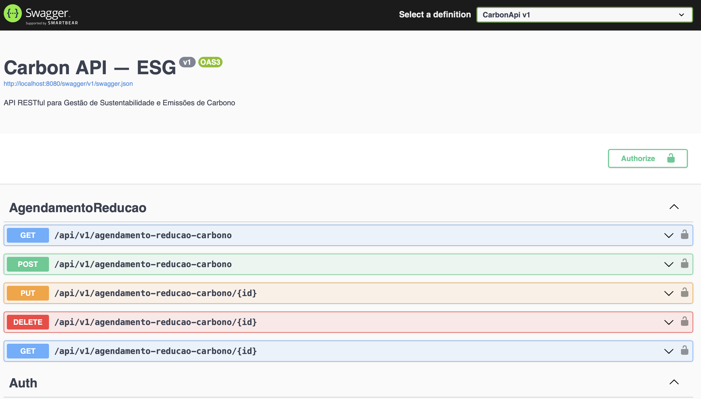 |
| `docker compose ps` — serviços healthy | 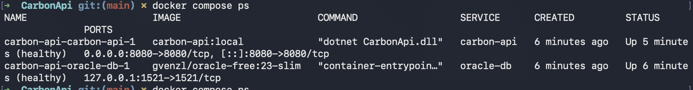 |
| Migrations automáticas + `/health/ready` | 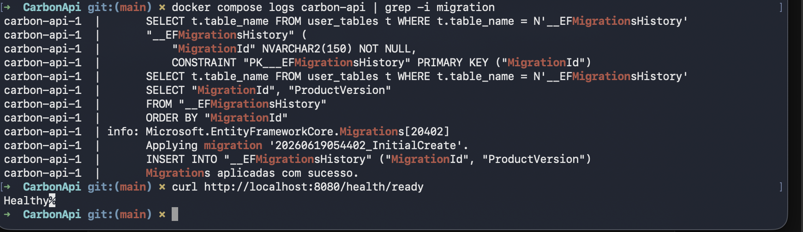 |
| Login JWT | 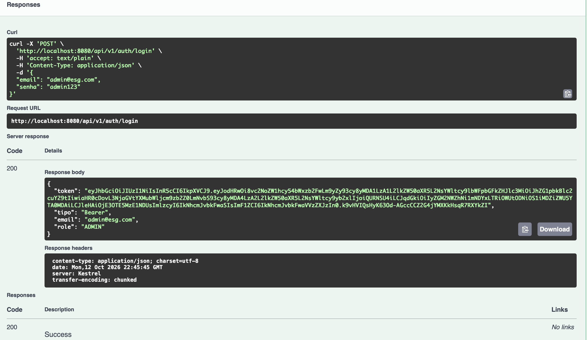 |
| Empresa criada (201) | 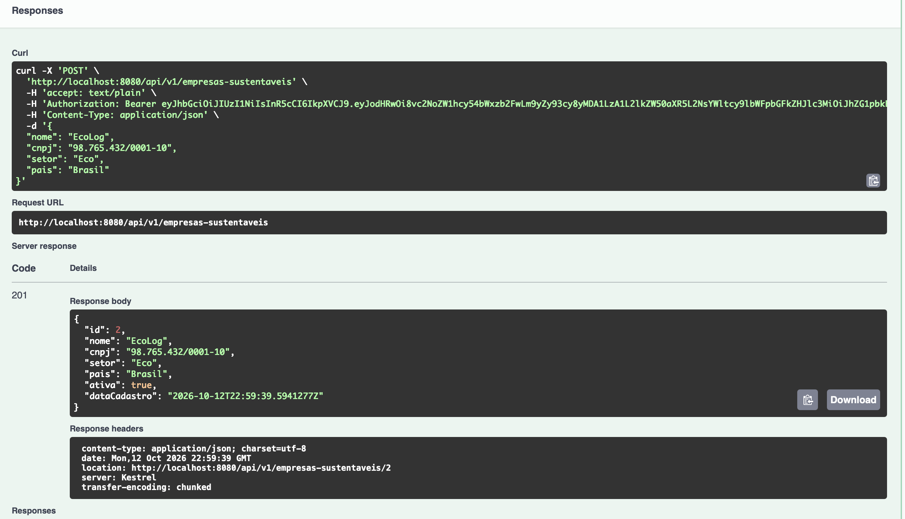 |
| Listagem de empresas | 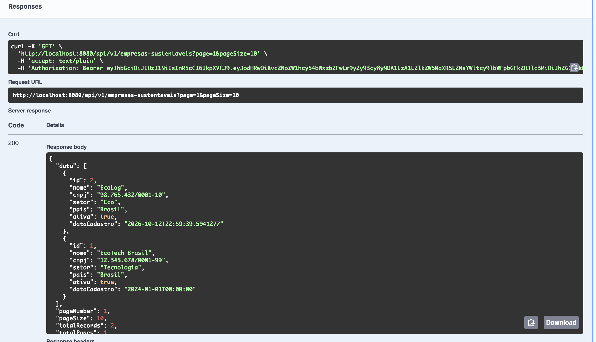 |
| Persistência após `down`/`up` | 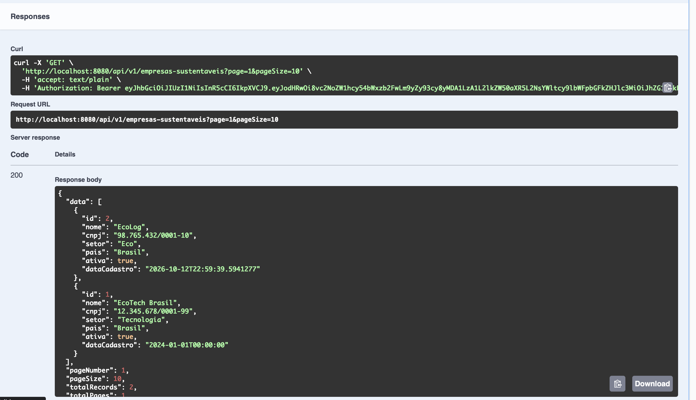 |
| Rede e volume | 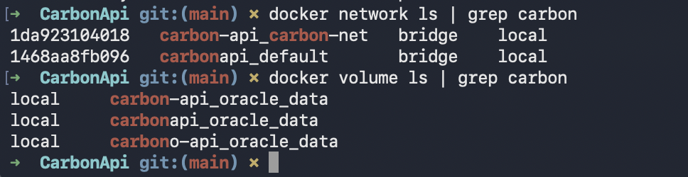 |

### Pipeline CI/CD
| Evidência | Print |
|---|---|
| Workflow — jobs encadeados | 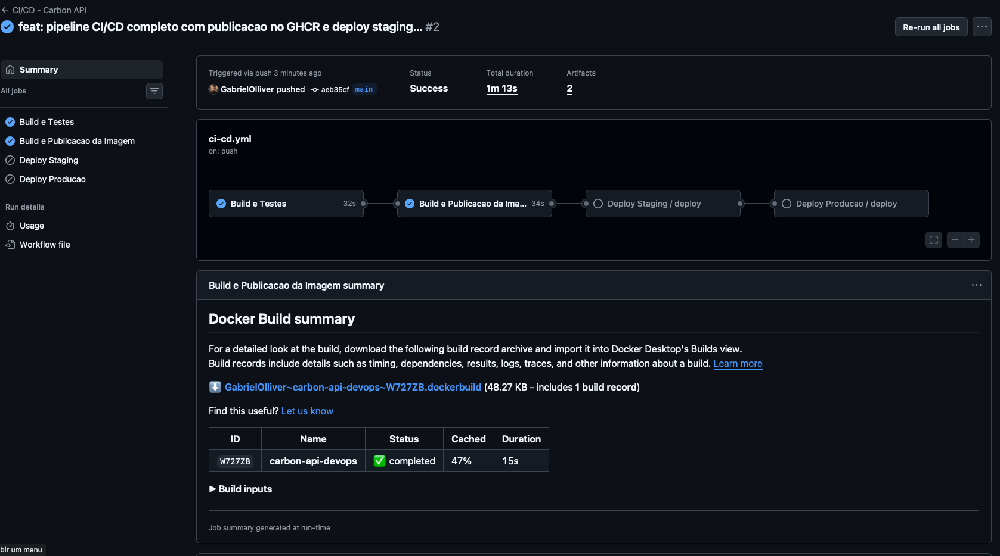 |
| Testes automatizados (10/10) | 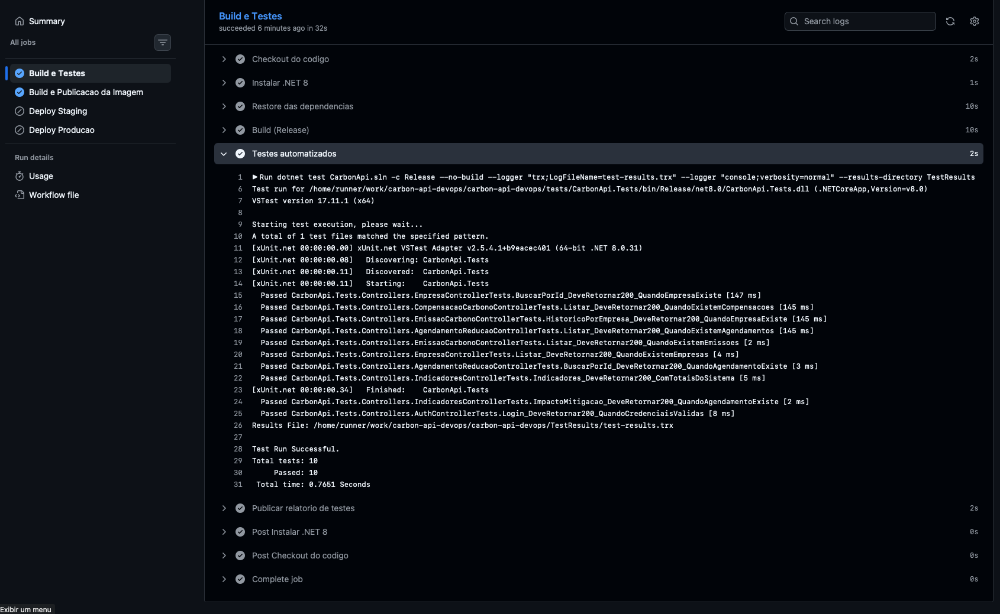 |
| Artifacts (relatório de testes) | 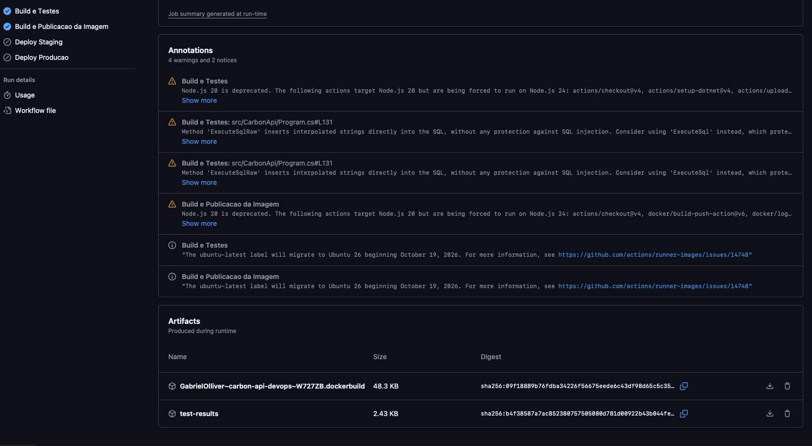 |
| VM Azure com Docker | 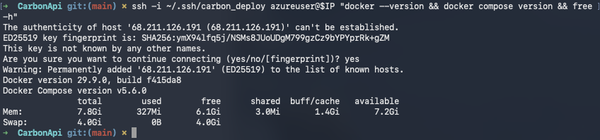 |
| GitHub Environments | 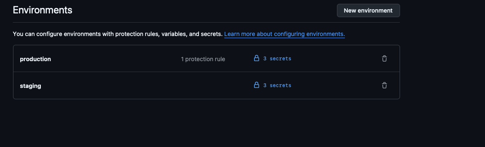 |
| Aprovação manual de produção | 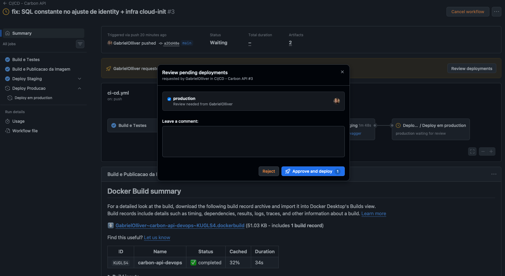 |
| Deploy em staging | 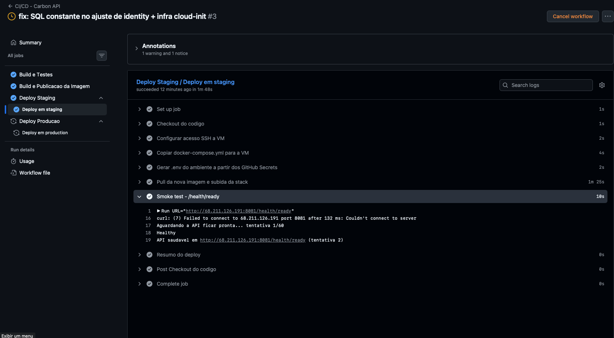 |
| Pipeline completo (4 jobs) | 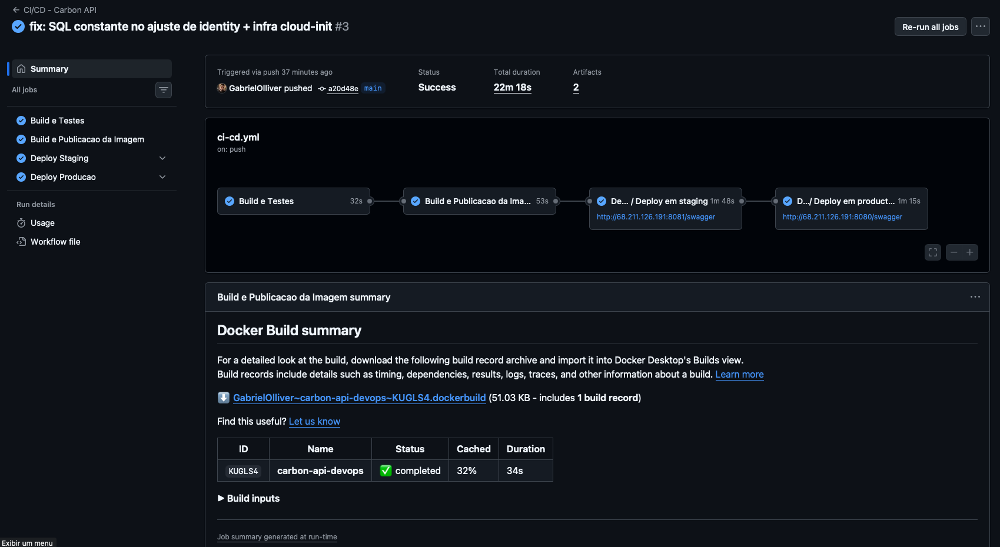 |

### Ambientes no ar
| Ambiente | URL | Print |
|---|---|---|
| Staging | http://68.211.126.191:8081/swagger | 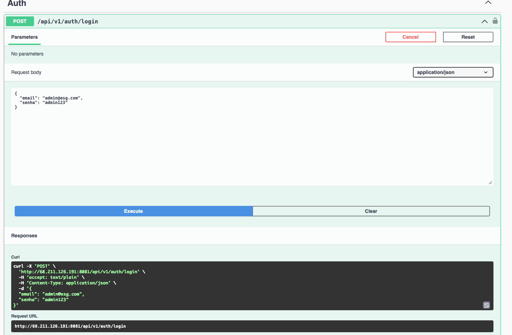 |
| Produção | http://68.211.126.191:8080/swagger | 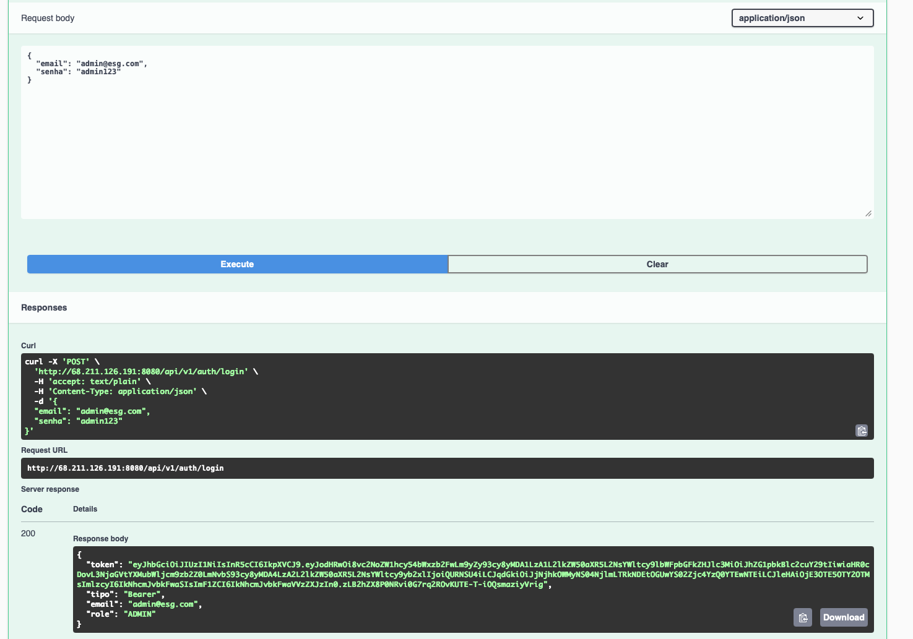 |

---

## 🛠️ Tecnologias utilizadas

| Categoria | Tecnologias |
|---|---|
| **Aplicação** | .NET 8, ASP.NET Core Web API, Entity Framework Core 8, FluentValidation, JWT Bearer, BCrypt, Swagger/OpenAPI |
| **Banco de dados** | Oracle Database 23ai Free (`gvenzl/oracle-free:23-slim`) |
| **Testes** | xUnit, Moq, FluentAssertions |
| **Containerização** | Docker (multi-stage), Docker Compose |
| **CI/CD** | GitHub Actions, GitHub Environments, GitHub Secrets, GitHub Container Registry (GHCR) |
| **Infraestrutura** | Microsoft Azure (VM Ubuntu 22.04), Azure CLI, cloud-init, SSH |
| **Observabilidade** | ASP.NET Core Health Checks (`/health`, `/health/ready`) |

---

## 📋 Endpoints Disponíveis

### 🔐 Autenticação
| Método | Endpoint | Acesso | Descrição |
|---|---|---|---|
| `POST` | `/api/v1/auth/login` | Público | Autenticar e obter token JWT |

### 🏢 Empresas
| Método | Endpoint | Acesso | Descrição |
|---|---|---|---|
| `GET` | `/api/v1/empresas-sustentaveis` | Autenticado | Listar empresas com paginação |
| `GET` | `/api/v1/empresas-sustentaveis/{id}` | Autenticado | Buscar empresa por ID |
| `POST` | `/api/v1/empresas-sustentaveis` | Somente ADMIN | Cadastrar nova empresa |

### 🌿 Emissões de Carbono
| Método | Endpoint | Acesso | Descrição |
|---|---|---|---|
| `GET` | `/api/v1/emissoes-carbono` | Autenticado | Listar emissões com paginação |
| `GET` | `/api/v1/historico-emissoes/{empresaId}` | Autenticado | Histórico por empresa |
| `POST` | `/api/v1/relatorio-emissao` | ADMIN/EMPRESA | Registrar nova emissão |

### 📅 Agendamentos de Redução
| Método | Endpoint | Acesso | Descrição |
|---|---|---|---|
| `GET` | `/api/v1/agendamento-reducao-carbono` | Autenticado | Listar agendamentos com paginação |
| `GET` | `/api/v1/agendamento-reducao-carbono/{id}` | Autenticado | Buscar agendamento por ID |
| `POST` | `/api/v1/agendamento-reducao-carbono` | ADMIN/EMPRESA | Criar agendamento |
| `PUT` | `/api/v1/agendamento-reducao-carbono/{id}` | ADMIN/EMPRESA | Atualizar agendamento |
| `DELETE` | `/api/v1/agendamento-reducao-carbono/{id}` | ADMIN/EMPRESA | Cancelar agendamento |

### 🌱 Compensação de Carbono
| Método | Endpoint | Acesso | Descrição |
|---|---|---|---|
| `GET` | `/api/v1/compensacao-carbono` | Autenticado | Listar compensações com paginação |
| `POST` | `/api/v1/compensacao-carbono` | ADMIN/EMPRESA | Cadastrar compensação |

### 📊 Indicadores
| Método | Endpoint | Acesso | Descrição |
|---|---|---|---|
| `GET` | `/api/v1/indicadores-sustentabilidade` | Autenticado | Indicadores gerais do sistema |
| `GET` | `/api/v1/impacto-mitigacao/{id}` | Autenticado | Impacto estimado de uma ação |

---

## ✅ Checklist de entrega

| Item | OK |
|---|---|
| Projeto compactado em .ZIP com estrutura organizada | ☑ |
| Dockerfile funcional | ☑ |
| docker-compose.yml ou arquivos Kubernetes | ☑ |
| Pipeline com etapas de build, teste e deploy | ☑ |
| README.md com instruções e prints | ☑ |
| Documentação técnica com evidências (PDF ou PPT) | ☑ |
| Deploy realizado nos ambientes staging e produção | ☑ |
