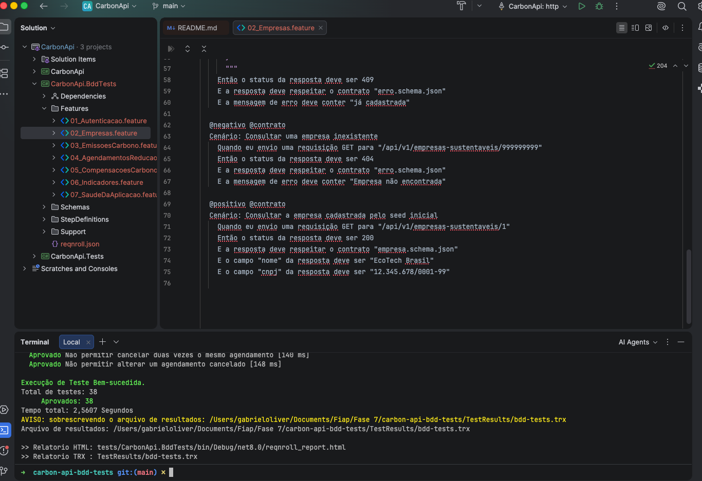
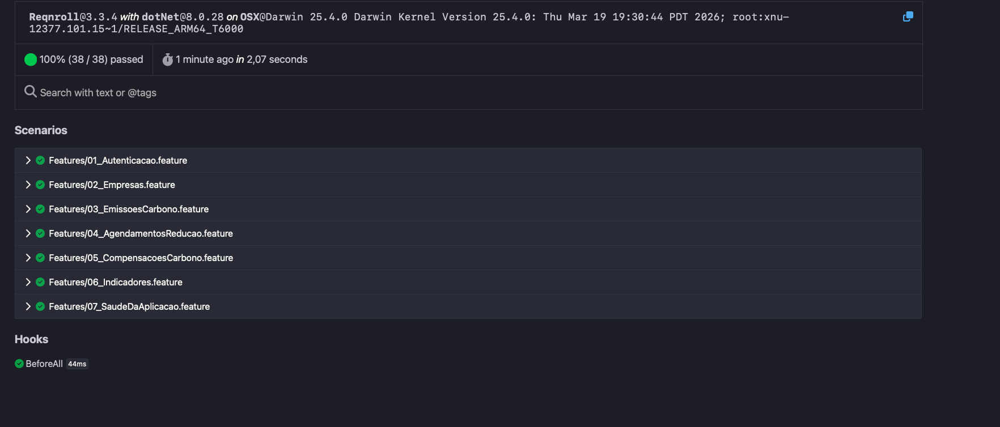
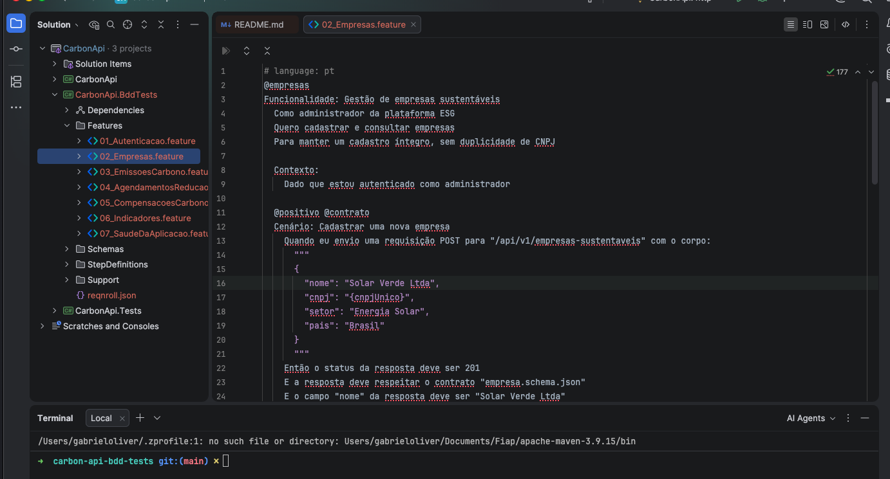
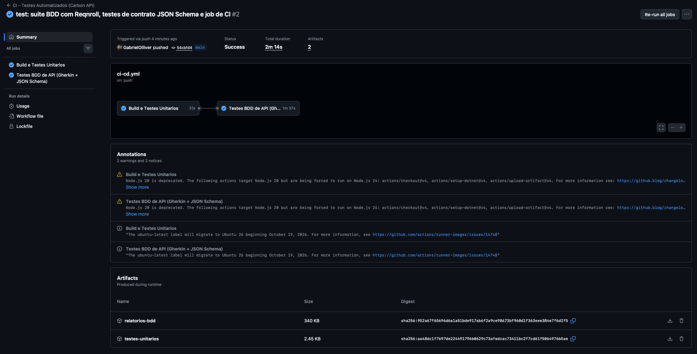
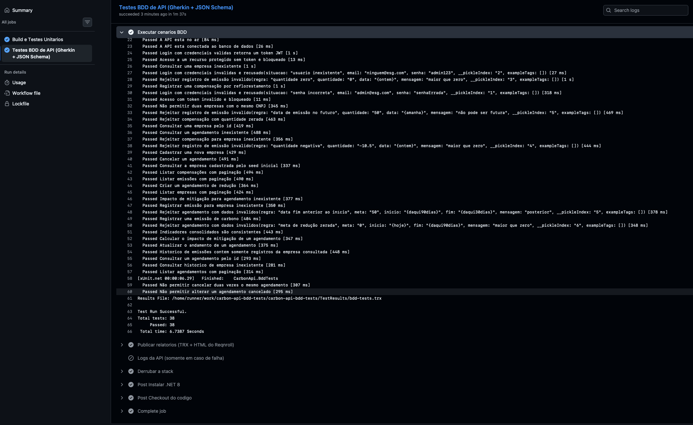
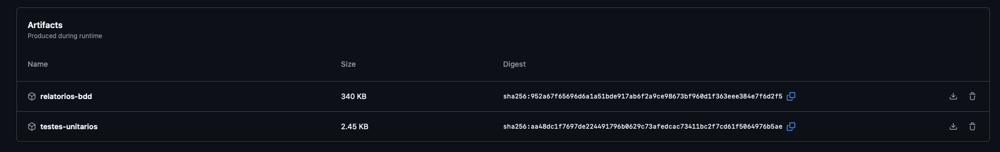

# Carbon API — Testes Automatizados com BDD

Suíte de **testes automatizados de API** escrita em **BDD (Behavior Driven Development) com Gherkin** para a **Carbon API**, uma API REST em .NET 8 de gestão de emissões, reduções e compensações de carbono (tema ESG).

Os cenários descrevem, em português, o comportamento esperado da API e são executados contra a **stack real** (API + Oracle em Docker), validando **status code, corpo JSON e contrato (JSON Schema)** de **todos os endpoints**.

| Campo | Informação |
|---|---|
| **Instituição** | FIAP — Análise e Desenvolvimento de Sistemas |
| **Fase** | Testes Automatizados |
| **Equipe** | Gabriel Alves Oliveira – RM562365<br>Marcos Antão Fernandes Junior – RM563156<br>Marcos Eduardo Alves de Oliveira Freitas – RM555914<br>Danilo Ferreira Chaves – RM565765<br>Hevilyn Romano Garcia – RM566426 |
| **Repositório** | https://github.com/GabrielOlliver/carbon-api-bdd-tests |

---

## 🌱 Integração com ESG

O foco da suíte é o pilar **Governança e compliance ambiental** — testes que asseguram **integridade, rastreabilidade e conformidade** dos dados ambientais (cenários com a tag `@governanca`):

| Garantia | Cenário |
|---|---|
| **Integridade cadastral** — não existem duas empresas com o mesmo CNPJ | `Não permitir duas empresas com o mesmo CNPJ` |
| **Rastreabilidade** — o histórico de emissões de uma empresa contém apenas registros dela | `Histórico de emissões contém somente registros da empresa consultada` |
| **Confiabilidade do inventário de GEE** — emissões com quantidade ≤ 0 ou data futura são rejeitadas | `Rejeitar registro de emissão inválido` |
| **Coerência dos indicadores publicados** — saldo líquido = total emitido − total compensado | `Indicadores consolidados são consistentes` |
| **Controle de acesso** — dados ambientais só são acessados por usuários autenticados | `Acesso a um recurso protegido sem token é bloqueado` |
| **Auditoria de decisões** — agendamento cancelado não pode ser alterado | `Não permitir alterar um agendamento cancelado` |

Também contribui com **eficiência de recursos computacionais**: a stack de teste é efêmera (sobe, testa e é destruída) e os cenários rodam em paralelo.

---

## 🧰 Tecnologias

| Ferramenta | Uso |
|---|---|
| **Reqnroll 3.3** | Framework BDD para .NET — sucessor open-source do **SpecFlow** (descontinuado em 2024), com a mesma sintaxe Gherkin |
| **Gherkin (pt-BR)** | Linguagem dos cenários (`Funcionalidade`, `Cenário`, `Dado`, `Quando`, `Então`) |
| **xUnit** | Executor dos testes (`dotnet test`) |
| **HttpClient** | Chamadas HTTP reais à API |
| **NJsonSchema** | Validação de contrato com **JSON Schema (draft-07)** |
| **FluentAssertions** | Asserções legíveis e mensagens de erro claras |
| **Docker Compose** | Sobe API + Oracle 23ai para o teste |
| **GitHub Actions** | Execução automática em CI a cada push |

---

## 📁 Estrutura

```
tests/CarbonApi.BddTests/
├── Features/                      ← cenários em Gherkin (o "o quê")
│   ├── 01_Autenticacao.feature
│   ├── 02_Empresas.feature
│   ├── 03_EmissoesCarbono.feature
│   ├── 04_AgendamentosReducao.feature
│   ├── 05_CompensacoesCarbono.feature
│   ├── 06_Indicadores.feature
│   └── 07_SaudeDaAplicacao.feature
├── StepDefinitions/               ← código C# de cada passo (o "como")
│   ├── AutenticacaoSteps.cs       (login, sem token, token inválido)
│   ├── PreCondicoesSteps.cs       (cria empresa/emissão/agendamento via API)
│   ├── RequisicaoSteps.cs         (GET/POST/PUT/DELETE genéricos)
│   ├── ValidacaoSteps.cs          (status, campos JSON, contrato)
│   └── GovernancaEsgSteps.cs      (regras de coerência dos indicadores)
├── Support/
│   ├── ApiContext.cs              (estado do cenário, HttpClient, variáveis)
│   └── Hooks.cs                   (verifica se a API está no ar antes da suíte)
├── Schemas/                       ← 12 contratos JSON Schema
└── reqnroll.json                  (Gherkin em português + relatório HTML)
scripts/run-bdd-tests.sh           ← execução local em um comando
.github/workflows/ci-cd.yml        ← pipeline de CI
```

---

## 🧪 Cenários e cobertura

**38 testes** (32 cenários + linhas de *Esquema do Cenário*) cobrindo **todos os endpoints**:

| Feature | Endpoints | Positivos | Negativos |
|---|---|---|---|
| Autenticação | `POST /auth/login` + proteção JWT | login válido | senha errada, usuário inexistente (422), sem token (401), token inválido (401) |
| Empresas | `GET /empresas-sustentaveis`, `GET /{id}`, `POST` | cadastrar, listar paginado, buscar por id, empresa do seed | CNPJ duplicado (409), id inexistente (404) |
| Emissões | `POST /relatorio-emissao`, `GET /emissoes-carbono`, `GET /historico-emissoes/{id}` | registrar, listar, histórico rastreável | quantidade 0 / negativa, data futura (422), empresa inexistente (404) |
| Agendamentos | `POST`, `GET`, `GET /{id}`, `PUT /{id}`, `DELETE /{id}` | criar, listar, buscar, atualizar, cancelar | data fim < início, meta 0 (422), alterar cancelado (422), cancelar 2× (422), inexistente (404) |
| Compensações | `POST /compensacao-carbono`, `GET` | registrar reflorestamento, listar | quantidade 0 (422), empresa inexistente (404) |
| Indicadores | `GET /indicadores-sustentabilidade`, `GET /impacto-mitigacao/{id}` | indicadores coerentes, cálculo do impacto | agendamento inexistente (404) |
| Saúde | `GET /health`, `GET /health/ready` | API no ar, API conectada ao banco | — |

### Exemplo de cenário

```gherkin
# language: pt
@empresas
Funcionalidade: Gestão de empresas sustentáveis
  Como administrador da plataforma ESG
  Quero cadastrar e consultar empresas
  Para manter um cadastro íntegro, sem duplicidade de CNPJ

  Contexto:
    Dado que estou autenticado como administrador

  @negativo @contrato @governanca
  Cenário: Não permitir duas empresas com o mesmo CNPJ
    Dado que existe uma empresa cadastrada
    Quando eu envio uma requisição POST para "/api/v1/empresas-sustentaveis" com o corpo:
      """
      { "nome": "Empresa Duplicada", "cnpj": "{empresaCnpj}", "setor": "Varejo", "pais": "Brasil" }
      """
    Então o status da resposta deve ser 409
    E a resposta deve respeitar o contrato "erro.schema.json"
    E a mensagem de erro deve conter "já cadastrada"
```

### O que cada teste valida

| Validação | Passo Gherkin |
|---|---|
| **Status code** | `Então o status da resposta deve ser 201` |
| **Corpo JSON** | `E o campo "nome" da resposta deve ser "Solar Verde Ltda"` |
| **Contrato (JSON Schema)** | `E a resposta deve respeitar o contrato "empresa.schema.json"` |

Os schemas usam `additionalProperties: false` e `required` em todos os campos: se a API **adicionar, remover ou mudar o tipo** de um campo, o teste de contrato falha — protegendo quem consome a API.

### Boas práticas aplicadas
- **Sem mocks**: os testes falam com a API real por HTTP (teste de integração entre serviços).
- **Cenários independentes**: cada cenário cria os próprios dados via API (`Dado que existe uma empresa cadastrada`).
- **Dados únicos por execução**: CNPJ aleatório (`{cnpjUnico}`), evitando conflitos ao reexecutar.
- **Datas dinâmicas**: `{ontem}`, `{amanha}`, `{daqui90dias}` — os testes não “envelhecem”.
- **Tags** para executar grupos: `@positivo`, `@negativo`, `@contrato`, `@governanca`, `@empresas`…

---

## ▶️ Como executar

### Pré-requisitos
- Docker Desktop (com ~4 GB de RAM livres para o Oracle)
- .NET SDK 8

### 1. Configurar o ambiente
```bash
git clone https://github.com/GabrielOlliver/carbon-api-bdd-tests.git
cd carbon-api-bdd-tests
cp .env.example .env          # ajuste as senhas
openssl rand -hex 32          # cole o resultado em JWT_SECRET no .env
```

### 2. Executar tudo com um comando
```bash
./scripts/run-bdd-tests.sh
```
O script sobe API + Oracle (`docker compose up`), aguarda o `/health/ready` e executa os cenários.

### Execução manual / por tags
```bash
docker compose up -d --build                                # sobe a stack
dotnet test tests/CarbonApi.BddTests                        # todos os cenários
dotnet test tests/CarbonApi.BddTests --filter "Category=empresas"     # só uma feature
dotnet test tests/CarbonApi.BddTests --filter "Category=negativo"     # só caminhos de falha
dotnet test tests/CarbonApi.BddTests --filter "Category=governanca"   # só regras ESG
docker compose down -v                                      # derruba e limpa
```

### Testar outro ambiente
A URL da API é configurável:
```bash
API_BASE_URL=http://meu-servidor:8081 dotnet test tests/CarbonApi.BddTests
```

### Relatórios gerados
| Relatório | Local |
|---|---|
| HTML do Reqnroll (cenários, passos, tempos) | `tests/CarbonApi.BddTests/bin/Debug/net8.0/reqnroll_report.html` |
| TRX (padrão do .NET / Azure DevOps) | `TestResults/bdd-tests.trx` |

---

## 🔄 Integração Contínua (GitHub Actions)

Arquivo: [`.github/workflows/ci-cd.yml`](.github/workflows/ci-cd.yml) — roda a cada push/PR na `main`.

| Job | Etapas |
|---|---|
| **1. Build e Testes Unitários** | restore → build Release → testes unitários (xUnit + Moq) |
| **2. Testes BDD de API** | gera `.env` efêmero com senhas aleatórias → `docker compose up` (API + Oracle no runner) → aguarda `/health/ready` → executa os cenários Gherkin → publica relatórios (TRX + HTML) → `docker compose down -v` |

O job BDD só roda se o build e os testes unitários passarem (`needs`). Em caso de falha, os logs da API são impressos automaticamente.

---

## 📸 Evidências

| Evidência | Print |
|---|---|
| Execução local — 38/38 aprovados |  |
| Relatório HTML do Reqnroll |  |
| Cenários Gherkin no editor |  |
| Pipeline de CI (2 jobs) |  |
| Cenários executados no CI |  |
| Relatórios publicados como artifacts |  |
